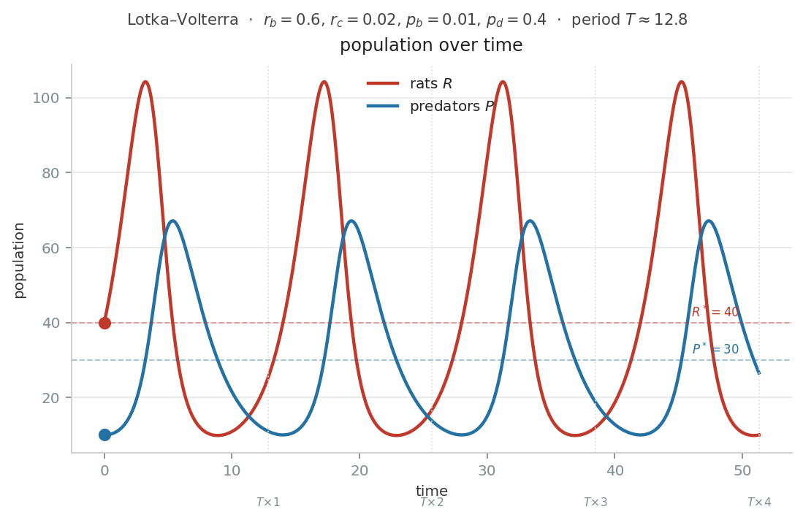
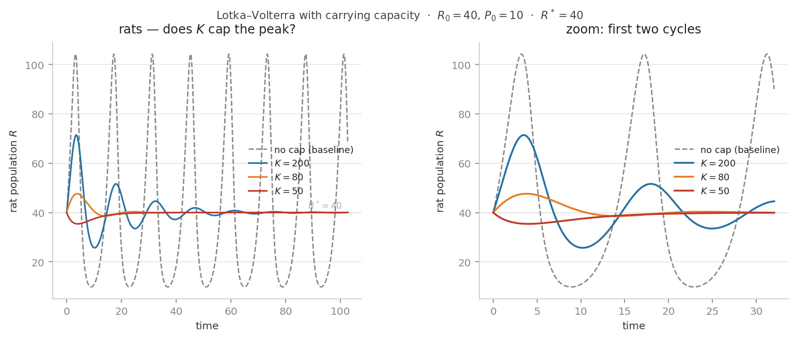



Rats have been a hot topic in Taipei recently. Residents report seeing more rats than before.

In response to this so-called "rat plague," Taipei City has been distributing rat poison. However, the [Raptor Research Group of Taiwan points out](https://udn.com/news/story/7323/9478014) that using rat poison doesn't actually reduce the rat population — it increases it instead.

That's because while rat poison kills rats, it also poisons the hawks that eat rats.
Rats can't be wiped out in one shot with poison, and the survivors reproduce enormously fast in a very short time. Hawks, on the other hand, have few offspring and take a long time to mature.

So after a while, the newly born rats have no hawks left to prey on them and keep their numbers in check. Rats end up running rampant.

Because this is a somewhat complex dynamic with subtle causal relationships, I sensed there was some math running under the hood.

After a bit of research, I fell down a rat hole — trying to answer one question just fished up more questions. The math of rats turned out to hold a lot of counterintuitive insights.

The band-aid approach — see a rat, deal with the rat — ends up leaving the hawks to pay off the rats' karmic debt. Try to wipe rats out completely with poison, and the result is that there end up being even more rats.

There's also a competing policy recommendation to rat poison: "keep rats from coming, keep rats from settling, keep rats from eating." The intent is to reduce the rat population at the source. Is this actually the better approach? Math says starving rats out doesn't work quite the way you'd imagine.

Full disclosure up front: I'm not a Taipei resident, and I haven't experienced the impact of rats firsthand.

I also have no background in ecology or public health. Please don't treat this as a serious discussion of a public policy issue.

Instead, I wanted to pick a topic I'm unfamiliar with and see how mathematical models from other fields work. I wanted to explore what mathematical modeling can and can't do — treating a live, ongoing issue as a math exercise.

## The Lotka–Volterra Equations

Lotka–Volterra is a century-old formula that captures the dynamics between predator and prey. In our setting, the prey is rats, and the predator can be hawks.

The equations aren't as scary as they look. Let's briefly introduce them to help with the discussion later.

$$\frac{dR}{dt} = r_b R - r_c R P$$

$$\frac{dP}{dt} = p_b R P - p_d P$$

These two equations describe how rats and hawks change over time. Pick whatever time unit you like — below I'll interchangeably use "next period" and "tomorrow," both meaning the next time step.

Here $R$ is the number of rats, and $P$ is the number of hawks.
$dR/dt$ means how the rat population changes tomorrow, and $dP/dt$ is how the hawk population changes.

Tomorrow's change in the rat population is newly born rats minus rats eaten by hawks.

- New rats, $r_b R$: the rat birth rate $r_b$ times the current number of rats $R$.
- How many rats get eaten, $r_c R P$: this depends on how many "rat dishes" are on the menu today, and how many hawks are being served. We add a predation-rate parameter $r_c$ to adjust how many rats get eaten. You can interpret the predation rate as how unlucky a rat wandering around outside is to get caught.

Now let's look at tomorrow's change in the hawk population. Hawks grow when there's enough food, and decline from natural death.

- Hawk growth, $p_b R P$: the rats eaten for dinner today become the nutrients that hatch baby hawks. More available food means more hawks are born. $p_b$ can be thought of as a birth rate.
- Natural hawk death, $p_d P$: the death rate $p_d$ times the current number of hawks $P$.

Let's work through a concrete example:

Suppose today there are 40 rats ($R = 40$) and 10 hawks ($P = 10$), with the following parameters:

- Rat birth rate $r_b = 0.6$
- Predation rate $r_c = 0.02$ (the probability of any given hawk catching any given rat)
- Hawk death rate $p_d = 0.4$
- Hawk growth rate $p_b = 0.01$

Plugging into the rat equation:

$$\frac{dR}{dt} = r_b R - r_c R P = 0.6 \times 40 - 0.02 \times 40 \times 10 = 24 - 8 = +16$$

Today 24 new rats are born, 8 get eaten, and tomorrow the rat population becomes **56**.

Now the hawks:

$$\frac{dP}{dt} = p_b R P - p_d P = 0.01 \times 40 \times 10 - 0.4 \times 10 = 4 - 4 = 0$$

Today's food supply exactly offsets natural death, so tomorrow's hawk population stays **flat**, still 10.

Let's have the computer simulate 50 days; the rise and fall of rats and hawks is shown above.

I also had AI help me build an [interactive game](https://chihchengliang.github.io/rat_sim/), where you can try dosing out rat poison yourself and see whether you can control the population.

The first thing this model tells us is: predator and prey populations exhibit **periodic oscillation**.

When food is abundant, hawks increase in number, which leads to heavy predation and a decline in rats. Fewer rats means less food for hawks, so hawk numbers decline too. As hawk numbers fall, predation on rats drops again, so the rat population climbs back to where it started.

So when discussing rat populations, **we shouldn't assume they're a constant**. Rat numbers fluctuate.

The second thing the model tells us is that there's an equilibrium between the rat and hawk populations. Even though both populations are constantly fluctuating and almost never actually sit still at the equilibrium, we'll prove in the appendix that the equilibrium quantity happens to equal the average quantity over one full cycle in this model. That lets us use the equilibrium to discuss policy recommendations.

With zero human intervention, this model's equilibrium is solved as follows:

Suppose both the hawk and rat populations sit at a point that isn't moving at all — tomorrow's change is zero for both. $dR/dt = 0$ and $dP/dt = 0$.

This gives us:

$$\frac{dR}{dt} = r_b R - r_c R P = 0$$

so $R = 0$ or $P = r_b/r_c$

$$\frac{dP}{dt} = p_b R P - p_d P = 0$$

so $P = 0$ or $R = p_d/p_b$

Putting these together, only two combinations make sense:

$$(R^\ast, P^\ast) = (0,\ 0)$$

$$(R^\ast, P^\ast) = \left(\frac{p_d}{p_b},\ \frac{r_b}{r_c}\right)$$

The first equilibrium is total extinction of both rats and hawks. Zero rats means no new rats get born. No rats to eat means no new hawks get born either.

This equilibrium is unusual, and not very realistic.

The second equilibrium is the normal case.

What I've learned from doing math is: when you see a pile of variables $a, b, c, d$ jumbled together in an equation, look at which variables show up — and more importantly, **which ones don't**.

In the second equilibrium, **the equilibrium rat quantity $R^\ast$ is entirely determined by the hawks' parameters, $p_d/p_b$**! None of the rats' own parameters appear in it at all. So making rats have fewer babies, or easier to catch, or whatever — none of it changes the rat population at all.

So who do the rats' parameters actually affect? They affect the hawks!

Rats are, fundamentally, the hawks' food stockpile.

When hawks have fewer babies and die faster, the equilibrium rat quantity increases.

And when rats have more babies and are harder to catch, the hawks' food stockpile gets consumed more slowly, and the equilibrium hawk quantity increases.

## Policy intervention

Okay, now that we have a model describing rat population behavior, we can ask: which parameters do we "want to," or "are able to," intervene on from the outside? From a human-centric standpoint, is there any way to intervene that benefits the city's residents?

The first thing we can intervene on is the equilibrium of the rat or hawk population. In the Lotka–Volterra equations, the equilibrium quantity happens to be the average number of rats the city is exposed to per day over one cycle. So if we care about the average exposure, the equilibrium quantity is a reasonable proxy.

Some [news reports](https://news.ltn.com.tw/news/life/breakingnews/5425818) mention that rats chew through wiring, creating fire risk or equipment damage. This kind of loss is more closely tied to the average rat population, which is exactly what we can control via the equilibrium.

Besides the equilibrium, what else can we intervene on? For something like an epidemic, average exposure to rats might matter less than whether a population peak crosses the threshold that triggers an outbreak. So we might instead want to control the height of the rat population's peaks.

However, this model's cycle is nonlinear, and there's no closed-form solution for the peak height. So there's no direct parameter we can analyze for that. Don't worry — we'll find another way around this later.

Finally, the period itself is something we could try to intervene on. The model gives an approximate period, $T = \frac{2\pi}{\sqrt{r_b p_d}}$. Maybe lengthening the period between rat population peaks could reduce the risk of a disease outbreak. But since the analysis of the period doesn't have much of interest to say, this post skips over it entirely.

## Policy analysis

### Policy 1: Using rat poison

First, we need to discuss how rat poison is actually used.

We need to break this down by both type and frequency of intervention.

By type:

- The first kind is a "perfect" rat poison that only kills rats and doesn't harm hawks.
- The second kind is more realistic — it has bioaccumulation effects. When hawks eat rats that have eaten a lot of poison, the hawks are more likely to die. The Raptor Research Group's news report mentioned earlier notes that in recent testing, 92% of dead crested goshawk samples from Keelung and Taipei tested positive for rat poison.

On frequency, we can discuss either a one-time mass poisoning that removes existing rats and hawks, or ongoing, routine poisoning that removes animals every period.

A one-time mass poisoning that removes existing rats or hawks essentially just adjusts the initial state in the model, rather than changing the dynamics. Directly intervening on the state like that isn't very realistic anyway.

The model in this post isn't a lab weight-and-spring setup, nor a signal on an oscilloscope — even though the equations look similar. For a complex biological environment, this is a highly simplified model. It's not meant to capture real data for quantitative analysis, but rather to use the qualitative properties of its parameters for discussion.

It's periodic poisoning that actually changes the variables inside the differential equations.

Let's look at the first, "perfect" poison:

$$\frac{dR}{dt} = r_b R - r_c R P - k R$$

This poison's effect is to remove some rats every period, expressed as an extermination rate $k$ times the current rat population $R$.

Rearranging the terms:

$$\frac{dR}{dt} = (r_b - k) R - r_c R P$$

We find that, mathematically, spraying poison actually has the same effect as lowering the birth rate. We're just reducing how many new rats get added next period.

Laying out the equilibrium:

$$(R^\ast, P^\ast) = \left(\frac{p_d}{p_b},\ \frac{r_b - k}{r_c}\right)$$

Whoa — the rats didn't decrease at all, but the hawks did. Mathematically, the poison's effect is to reduce the hawks' food supply.

Now let's look at the second kind of poison, where we assume it harms rats and hawks with effects $k$ and $l$ respectively:

$$\frac{dR}{dt} = r_b R - r_c R P - k R$$

$$\frac{dP}{dt} = p_b R P - p_d P - l P$$

The effect on rats is the same as before; folding the hawk terms together is equivalent to an increase in the hawk death rate.

Looking at the equilibrium again:

$$(R^\ast, P^\ast) = \left(\frac{p_d + l}{p_b},\ \frac{r_b - k}{r_c}\right)$$

Whoa — after spraying poison, the rat population doesn't decrease, it *increases*! The more you spray, the more rats you get. What's going on here?

Because more hawks are dying, there are fewer hawks left to eat rats. So under this dynamic, rats actually end up increasing.

And we haven't even had to assume any difference in reproductive timing or fecundity between hawks and rats to reach this conclusion.

Wikipedia has a page called the [Paradox of the Pesticides](https://en.wikipedia.org/wiki/Paradox_of_the_pesticides), which describes exactly this result.

### Policy 2: "Keep rats from coming, keep rats from settling, keep rats from eating"

We need to unpack this phrase — what does it actually mean, concretely?

The [Taiwan CDC's website](https://www.cdc.gov.tw/Bulletin/Detail/t7U_mzNHOLqp8jDXZLkyhg?typeid=9) says:

> The public should routinely watch for potential rat entry points in the environment, properly manage household food waste or animal feed, and keep the environment clean at all times. Firebreak alleys, drainage facilities (sewers, drain covers), piles of clutter, and walls are hotspots for rat activity — please strengthen trapping and extermination efforts in these specific environments.

The CDC also mentions the transmission mechanism of hantavirus:

> Hantavirus syndrome is a zoonotic disease. In nature, rodents such as rats are the reservoir hosts. Humans risk infection by inhaling or contacting dust or objects contaminated by excrement or secretions (including feces, urine, saliva) from rats carrying hantavirus, or by being bitten by an infected rodent.

Reading these passages, it seems the CDC's main goal is to prevent people from contracting hantavirus. While trapping and extermination are mentioned, the goal is to keep rats away from homes or human activity spaces, reducing the public's exposure to rat excrement and thus infection risk.

Based on the text, the purpose of trapping and extermination here isn't to reduce the total number of rats in the city.

We can separately discuss trapping or extermination aimed at reducing the total rat population. Whether by poison or by trap, the goal is to remove next period's rats. Mathematically this shows up the same way — and the hawks end up bearing the consequences either way.

### Carrying capacity

The interesting point here is "keep rats from eating." There's a [claim](https://news.cts.com.tw/cna/life/202605/202605053027769.html) that poorly managed food and trash in cities gives rats abundant food, allowing the population to grow.

Can starving rats of food actually reduce the total rat population?

Our current model assumes rats have unlimited food — absent predators, they can have as many babies per period as they want.

$$\frac{dR}{dt} = r_b R $$

This runs our model straight into the [chicken-and-egg problem](https://vocus.cc/article/69bf55e6fd89780001148eb9). We've already baked the conclusion into our model's assumptions: because rats have abundant food, limiting food has no effect on rats in this model. That's not good.

Luckily, our model is like a bowl of plain tofu pudding — we can add whatever toppings we like.

We can install a Malthusian ceiling for the rats: assume the city has a carrying capacity $K$ for rats. As the rat population approaches the ceiling, growth slows down. Cross the ceiling, and the population goes negative.

$$\frac{dR}{dt} = r_b R \left(1 - \frac{R}{K}\right)$$

This lets us discuss what happens to the rat population if we assume trash and food waste are brought under control, lowering the ceiling.

The updated equation is below — rat births are suppressed by the term $(1-R/K)$.

$$\frac{dR}{dt} = r_b R \left(1 - \frac{R}{K}\right) - r_c R P$$

$$\frac{dP}{dt} = p_b R P - p_d P$$

Following the same steps as before:

The predator equation still gives us $P = 0$ or $R^\ast = p_d/p_b$

$$\frac{dR}{dt} = r_b R \left(1 - \frac{R}{K}\right) - r_c R P = 0$$

so $R = 0$ or

$$P^\ast = \frac{r_b}{r_c}\left(1 - \frac{R^\ast}{K}\right) = \frac{r_b}{r_c}\left(1 - \frac{p_d/p_b}{K}\right)$$

Whoa — the equilibrium rat population isn't affected at all! The consequences of the carrying capacity are, once again, borne by the hawks.

And there's a **frightening ecological consequence** here. For the equilibrium hawk quantity to be positive, i.e. $P^\ast > 0$, we need $(1 - R^\ast/K)$ to be positive. In other words, the total rat population must not exceed the carrying capacity — or, put another way, the carrying capacity must not be a binding constraint on the rat population.

If overly aggressive food-waste and trash policy pushes the rat population down too far, the equilibrium ends up at $(P, R) = (0,\ K)$ — the hawks all starve to death, and the rats grow all the way up to the carrying-capacity ceiling.

### An unexpected damping effect from the carrying capacity

By the time I'd written this far, I had accepted the conclusion that the consequences of squeezing the rats always land on the hawks.

Then, after plotting the rat population, I found something surprising!

The carrying-capacity ceiling actually does have a benefit! As the figure below shows, the ceiling produces something like a damping effect — over the long run it flattens out the rat population's oscillations.

When $K > R^\ast$, if the rat population overshoots the equilibrium, the carrying-capacity ceiling does slow down the rate at which rats keep growing — which can be explained as competition for food and crowding of space making it harder for rats to survive. But conversely, adding this ceiling setting also means that when the rat population is below equilibrium, it should bounce back faster than in a setup without a ceiling, since there's no competition for food or space when rats are scarce, so growth is faster.

Put the two effects together, and the carrying-capacity ceiling buffers the rat population's oscillations.

For policy purposes, the sweet spot for the carrying-capacity ceiling should sit just a bit above the equilibrium rat quantity, $K > R^\ast$. This suppresses the height of rat population peaks without doing too much damage to the hawks' survival.

Note that damping takes a few cycles to kick in. If you implement this policy in the middle of a current rat outbreak, you won't see the effect right away.

## Summary

Let's briefly summarize the counterintuitive things this model tells us so far.

| Policy | Intuitive expectation | Model prediction | Reason |
|------|----------|----------|------|
| Perfect rat poison (kills only rats) | Rat population decreases | Rat equilibrium **unchanged**, hawk equilibrium decreases | Equivalent to lowering the rat birth rate — it just reduces the hawks' food supply |
| Rat poison with bioaccumulation toxicity | Rat population decreases | Rat equilibrium **increases** | Hawk death rate rises, fewer natural predators |
| Lowering carrying capacity (cleaning up food waste and trash) | Rat population decreases | Rat equilibrium unchanged, hawk equilibrium decreases; if pushed too low, hawks go extinct; rat oscillations get dampened, reducing disease risk | Rat equilibrium is determined by predator parameters, independent of rats' own conditions; carrying capacity has a damping effect |
| Improving hawk habitat (lowering hawk death rate) | Shouldn't affect rats at all | Rat equilibrium **decreases** | Equilibrium rat quantity $R^\ast = p_d/p_b$ is directly affected by the predator's death rate |

The basic model tells us the rat problem doesn't look like a "treat the symptom where it hurts" kind of problem. It's more like the pain is in your foot but you need to treat your head, and vice versa.

**Seeing a rat, you can't just think about the rat.** To handle the rats, take care of the hawks first.

## Can we actually use this model's conclusions?

Now that the math is done, we can discuss whether these conclusions are actually usable.

I've actually found there's a fairly big problem.

The Lotka–Volterra equations still appear to be a [textbook](https://bio.libretexts.org/Bookshelves/Ecology/Book%3A_Quantitative_Ecology_-_A_New_Unified_Approach_(Lehman_Loberg_and_Clark)/16%3A_Competition/16.08%3A_Lotka-Volterra_formulation) model that gets introduced early on. [Empirically](https://link.springer.com/article/10.1007/s00442-020-04810-w), population oscillations do seem to exist and remain a topic of research — but the Lotka–Volterra equations themselves don't seem to come up much in that discussion anymore. One reason is that in many environments without predators, prey species still retain population oscillations on their own. So people may be more interested in other explanations.

In the setting we've used this model for, the biggest problems seem to be these assumptions:

We assumed the rat population is entirely controlled by hawks. This is actually the biggest chicken-and-egg problem here. It would be better if this assumption had some empirical backing.

Second, we assumed hawks only eat rats. For example, when discussing how an extreme carrying-capacity ceiling could drive hawks to extinction, we're assuming hawks can't find any other food source. Of course, the more appropriate discussion here would be: if we assume hawks can find other food, how would the dynamics change?

Finally, if a carrying-capacity ceiling can produce a damping effect, why do we still observe predator-prey oscillations in nature? A possible explanation is that nature is never permanently at equilibrium, or that the carrying-capacity ceiling isn't actually a constant, but has some randomness to it. These, too, need further reasoning.

We can see that a model can serve as a thinking tool — it forces us to write our assumptions down rigorously, and takes us past our intuitions. But it also just sets us loose halfway there; it's still not enough to arrive at a fully satisfying, consistent conclusion.

## Appendix

### Average quantity

Here we prove that the equilibrium quantity is the average quantity.

We use the predator equation:

$$\frac{dP}{dt} = p_b R P - p_d P$$

Dividing both sides by $P$:

$$\frac{1}{P}\frac{dP}{dt} = p_b R - p_d$$

The left side is $d(\ln P)/dt$, representing the percentage rate of change of $P$. Integrating over one full cycle $T$:

$$[\ln P]_0^T = p_b \int R dt - p_d T$$

Since $P$ is periodic, $\ln P(T) = \ln P(0)$, so the left side is zero:

$$0 = p_b \int R dt - p_d T$$

$$\frac{1}{T}\int R dt = \frac{p_d}{p_b}$$

Therefore:

$$\bar{R} = \frac{p_d}{p_b} = R^\ast$$

The average rat quantity over one cycle equals the equilibrium value. Applying the same steps to the rat equation gives $\bar{P} = P^\ast$.

The fact that the equilibrium quantity equals the average quantity over one cycle is actually a coincidental property of the Lotka–Volterra system. Adding more ingredients to the model breaks it. Once the equilibrium's properties are subjected to more realistic assumptions (such as a carrying-capacity ceiling, age structure, randomness), this may no longer hold.

### Disease

The basic reproduction number $R_0$ of a disease is:

$$R_0 = \frac{\lambda S}{\nu} \cdot R$$

where $\lambda$ is the human-rat transmission rate, $\nu$ is the recovery rate, and $S$ is the number of potentially susceptible people.

$R_0 > 1$ means the outbreak will spread. The key point is that $R_0$ scales linearly with the rat population $R$.

A rat population oscillating between 20 and 80 (with a mean of 50) is more dangerous than a population held steady at 50. The reason: when the count spikes to 80, it may push $R_0$ above 1 and trigger an outbreak — even if the average looks harmless. Infectious disease doesn't care about the average; it cares about whether a threshold gets crossed.

So when it comes to avoiding disease, we may care less about average rat exposure, and more about keeping the peak from getting too high.

### Deriving the period

The system:

$$\frac{dR}{dt} = r_b R - r_c R P, \qquad \frac{dP}{dt} = p_b R P - p_d P$$

Recall we have two equilibrium points:
- $(R^\ast, P^\ast) = (0,\ 0)$ — the trivial solution, total extinction
- $(R^\ast, P^\ast) = (p_d/p_b,\ r_b/r_c)$ — the coexistence equilibrium

#### Stability and linearization

We assume the state starts near equilibrium and shifts slightly away from it. This lets us observe whether the system spirals in toward equilibrium, spirals out away from it, or orbits around it on a fixed path. Spoiler: it orbits — which is exactly what lets us compute a period.

We linearize. Let:

$$R = R^\ast + r, \quad P = P^\ast + p$$

where $r, p$ are small perturbations. Substituting into the equations and dropping second-order terms ($rp \approx 0$):

$$
\frac{d(R^\ast+r)}{dt} = r_b (R^\ast + r) - r_c (R^\ast + r) (P^\ast + p)
$$

Expanding the rat equation and using the equilibrium condition $r_b R^\ast = r_c R^\ast P^\ast$ to cancel terms, with $r_c P^\ast = r_b$:

$$\frac{dr}{dt} = -r_c R^\ast \cdot p$$

Expanding the hawk equation and using the equilibrium condition $p_b R^\ast P^\ast = p_d P^\ast$ to cancel terms, with $p_b R^\ast = p_d$:

$$\frac{dp}{dt} = p_b P^\ast \cdot r$$

#### Linearized system

$$
\begin{pmatrix}
    \dot{r} \\\ \dot{p} 
\end{pmatrix} = 
\begin{pmatrix} 0 & -r_c R^\ast \\\ p_b P^\ast & 0 \end{pmatrix} 
\begin{pmatrix} r \\\ p \end{pmatrix}
$$

#### Eigenvalues

$$\det(A - \lambda I) = 0 \implies \lambda^2 + r_c p_b R^\ast P^\ast = 0 \implies \lambda = \pm i\sqrt{r_c p_b R^\ast P^\ast}$$

Purely imaginary eigenvalues — confirming the equilibrium is a "center," with the system orbiting around it, neither spiraling in nor spiraling out. Neutrally stable.

#### Oscillation period

The imaginary part of $\lambda$ is the angular frequency. Substituting $R^\ast = p_d/p_b$ and $P^\ast = r_b/r_c$:

$$\omega = \sqrt{r_c p_b \cdot \frac{p_d}{p_b} \cdot \frac{r_b}{r_c}} = \sqrt{r_b p_d}$$

The period is:

$$T = \frac{2\pi}{\omega} = \frac{2\pi}{\sqrt{r_b p_d}}$$

The period is the geometric mean of the rat birth rate and the hawk death rate. Rats being born faster and hawks dying faster both speed up the rise-and-fall cycle, shortening the period.

#### Conserved quantity

Dividing the two equations and separating variables:

$$\frac{r_b - r_c P}{P} dP = \frac{p_b R - p_d}{R} dR$$

Integrating both sides and rearranging gives a conserved quantity:

$$V(R,P) = p_b R - p_d \ln R + r_c P - r_b \ln P = C$$

Every trajectory is a level curve of $V$.

The level curves are orbits around the equilibrium point. Intervening on the state can push a trajectory's orbit outward or inward.

### Carrying-capacity ceiling

Repeating the linearization process above gives the linearized system for the version with a carrying-capacity ceiling:

$$
\begin{pmatrix}
    \dot{r} \\\ \dot{p} 
\end{pmatrix} = 
\begin{pmatrix} - r_b R^\ast / K & -r_c R^\ast \\\ p_b P^\ast & 0 \end{pmatrix} 
\begin{pmatrix} r \\\ p \end{pmatrix}
$$

$$\det(A - \lambda I) = 0 \implies \lambda^2 + r_b R^\ast / K \lambda + r_c p_b R^\ast P^\ast = 0$$

We can plug this into the quadratic formula to solve for the eigenvalues. The discriminant should be negative, giving an oscillating imaginary part — I didn't dig into this carefully. The key point is the negative real part in front, $- r_b R^\ast / 2K$, meaning the system spirals inward, converging to equilibrium.
